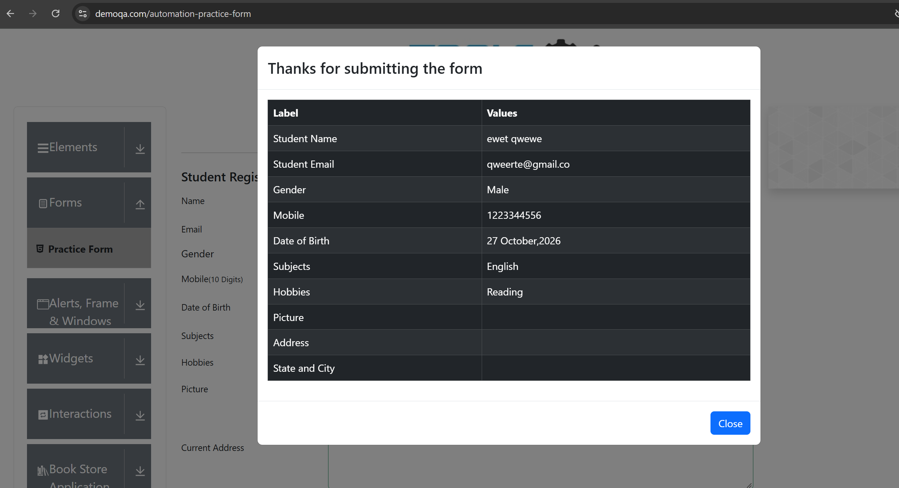
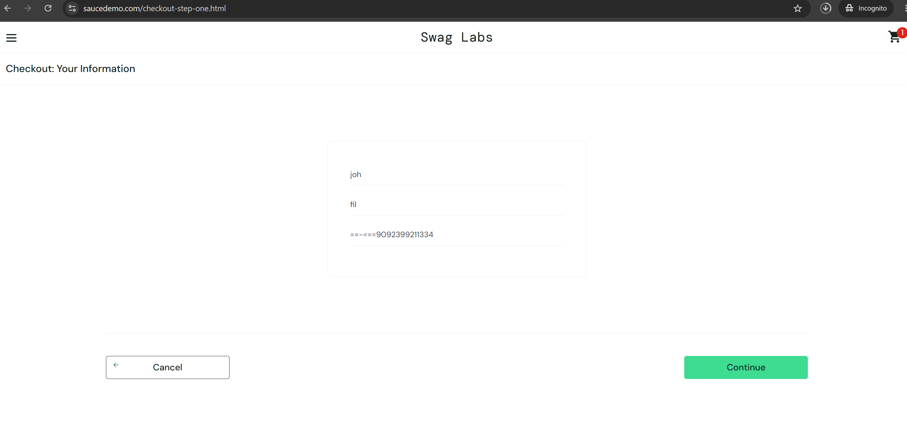

# Test Design 1: Groups and Edges
**Tester:** Chinedu · **Date:** 10/27/2026
**Techniques:** equivalence partitioning, boundary value analysis
## About this project
(I used the equivalence partitioning and Boundary value analysis for the rules, what matters it testing if i can find a bug)
## Part 1: Practice rules
### Rule A: a password must be 8 to 16 characters
| Group | Valid or invalid | Value I would test |
|---|---|---|
| 0, 8-16, 17 | Invalid, Valid, Invalid | 0, 10, 17 |
**Edges:**
| Value | What should happen |
|---|---|
| 7, 8, 16, 17 | 7 should refuse, 8 should accept, 16 should accept, 17 should refuse  |
### Rule B: a transfer of ₦100 to ₦50,000
| Group | Valid or Invalid | Value I would test |
|---|---|---|
| ₦0, ₦100-₦50,000, ₦51,000 | Invalid, Valid, Invalid | 0, 500, 51,000 | 
**Edges:**
| Value | What should happen |
|---|---|
| ₦99, ₦100, ₦50,000, ₦51,000 | ₦99 should refuse, ₦100 should accept, ₦50,000 should accept, ₦51,000 should refuse | 
### Rule C: free delivery for orders of ₦10,000 or more
| Group | Valid or Invalid | Value I would test |
|---|---|---|
| ₦0, ₦10,000 or more | Invalid, valid |  0, 10,000, 15,000 |
**Edges:**
| Value | What should happen |
|---|---|
| ₦9,999, ₦10,000, | 9,999 should refuse, 10, 000 should accept |
## Part 2: Sign-up form, ages 18 to 65
| ID | What it checks | Group or edge | Test data | Steps | Expected result |
|---|---|---|---|---|---|
| TC-01 | Empty | Group | 0 | Leave the form empty | Space shows invalid |
| TC-02 | To check if number between 18-65 | Group | 20 | Fill in the age from 20 | Age should be accepted |
| TC-03 | To check 66 above | Group | 66 | Fill in the age from 66 | Age should be refused |
| TC-04 | To check if a number lower than 18 | Edge | 17 | Fill in the number close to 18 which is 17 | Age should be refused |
| TC-05 | To check from the starting age 18 to see what happens | Edge | 18 | Fill in the age number which is 18 | Age should be accepted |
| TC-06 | To check from the ending age 65 to see what happens | Edge | 65 | Fill in the age number which is 65 | Age should be accepted |
| TC-07 | To check from age number above 65 which is 66 | Edge | 66 | Fill in the age number which is 66 | Age should be refused |

**Question for the team:**What if letters or emojis are entered into the form? Should the system allow them, or should it display a validation error?
## Part 3: DemoQA mobile number
**Site:** demoqa.com/automation-practice-form · **Browser:** Chrome Incognito · **Date:** 10/27/2026
**Rule:** the mobile number must be exactly 10 digits.
**Groups:** 3
**Edges:** 2
| ID | What it checks | Group or edge | Test data | Steps | Expected | Actual | Pass or Fail |
|---|---|---|---|---|---|---|---|
| TC-08 | To check what happens leaving the space | Group | Empty | Leaving the space empty | cant go through | Page didn't move | Fail |
| TC-09 | To check when 10 digits are filled in the space | Group | 10 | entered the 10 digits correctly | Display submitted successfully | Thanks for submitting | Pass |
| TC-10 | To check more than 10 digits | Group | 11 | Entered 11 digits | Cant go through | Page didn't move | Fail |
| TC-10 | To check if 9 digits | Edge | 9 | Entered 9 digits | Cant go through | Page didn't move | Fail |
| TC-11 | To check if 10 digits | Edge | 10 | Entered 10 digits | Submitted successfully | Thanks for submitting | Pass |
**Can a Nigerian user enter their number?** No
**Question for the team:** Should letters be allowed in a field that is intended to accept numbers only? 
### Evidence

## Part 4: SauceDemo checkout (no written rule)
**User:** standard_user · **Date:** 10/27/2026
### The rules I think each box should follow
- **First Name:** It must be a word
- **Last Name:** It must be a word
- **Postal Code:** It must be in numbers with six digits
### Postal Code groups
(0, 6, 7,)
| ID | What it checks | Group or edge | Test data | Steps | Expected | Actual | Pass or Fail |
|---|---|---|---|---|---|---|---|
| TC-12 | To check when the space is left empty | Group | Empty | Leaving the space empty | Should display Error | Displayed error  | Pass |
| TC-13 | To check when 6 digits are filled in the space | Group | 6 | Entered 6 digits in the space | Should display correct | Gave a room to add more digit | Fail |
| TC-14 | To check more than 6 digits | Group | 7 | Entered 7 digits in the space | Should display error | Gave a room to add more digits | Fail |
| TC-15 | 
### Questions for the team
- Should letters, emojis, and special characters be allowed in this field, or should the system reject them?

## Part 5: Interview practice
**Question:** A password box must be 8 to 20 characters. You cannot test every
password. What would you test, and why?
**My answer:** I would use equivalence partitioning and boundary value analysis and the group i would test the empty and exact number characters and above. At edges i would test 7, 8, 20, 21, and empty. I can test few not many, group behave same way and bugs can hide at the edges. 
## What I learned
- (I learnt how i can test a box space by group test and edge test)
- (I learnt that bugs can be found in edges)
- (I learnt i can be able to make rules for a test)
