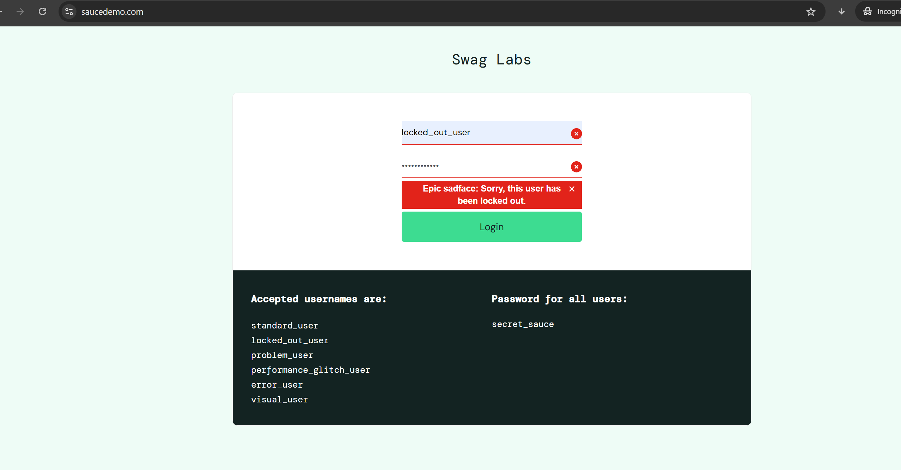
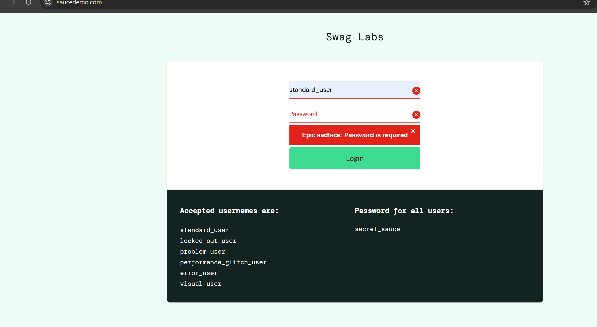
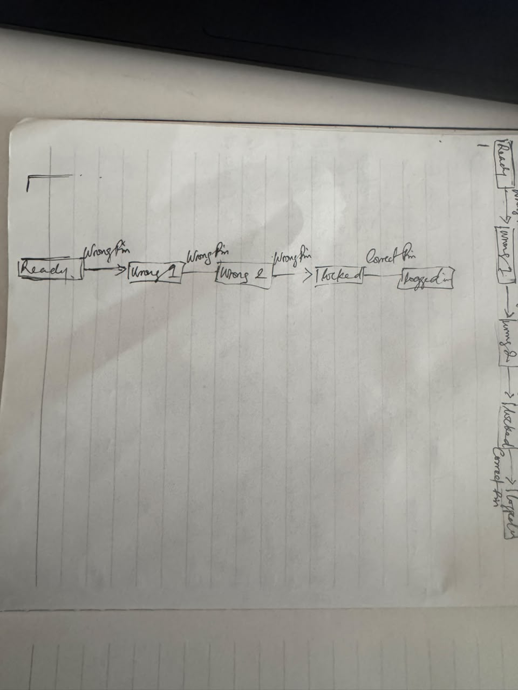

# Test Design 2: Rules, Memory and Smart Guesses
**Tester:** Chinedu · **Date:** 11/2/2026
## Assignment 1: Delivery fee table
| Question | Col 1 | Col 2 | Col 3 | Col 4 |
|---|---|---|---|---|
| Gold member? | Yes | Yes | No | No |
| Order ₦10,000 or more? | Yes | No | Yes | No |
| **What should happen** | Free(Discount) | Free | Free | ₦1,500 |
| ID | Column | Example customer | What should happen |
|---|---|---|---|
| TC-01 | 1 | Gold member | Gets free delivery and discount |
| TC-02 | 2 | Gold member | Gets free delivery | 
| TC-03 | 3 | Customer | Gets free delivery |
| TC-04 | 4 | Customer | Pays for the delivery |
**The column a tester would most likely forget:** Column 1 because the column meet the demands
## Assignment 2: SauceDemo login table
| Question | Col 1 | Col 2 | Col 3 | Col 4 | Col 5 |
|---|---|---|---|---|---|
| Username typed? | Yes| Yes | Yes | Yes | No |
| Password typed? | Yes | Yes | Yes | No | Yes |
| Do they match? | Yes | Yes | No | No | No |
| Account locked? | Yes | No | Yes | Yes | No |
| **What should happen** | Locked  message | Logged in | Details do not match | Password required | Username required |
**A mix that cannot happen, and why:** The mix is not possible to happen, there's no rule for it and rules cant make for such. therefore its a bug
| ID | Column | What I typed | What should happen | What really happened (exact message) | Pass or Fail |
|---|---|---|---|---|---|
| TC-01 | 1 | Typed correct Username, password | Should Login | This user has been locked out | Fail |
| TC-02 | 2 | Typed correct details | Should login | logged to the product page | Pass |
| TC-03 | 3 | Typed incorrect details | Cant get through | Details do not match | Pass |
| TC-04 | 4 | Typed  correct username no password | Cant get through | Password is required | Pass |
| TC-05 | 5 | Typed correct password no username | Cant get through | Username is required | Pass | 
**Both boxes empty:** Username is required and its not much helpful, it should include password is required

## Assignment 3: Bank PIN

| Where I am now | What I do | Where I end up |
|---|---|---|
| Ready | Wrong PIN | 1 wrong |
| Wrong PIN | 2 Wrong | Wrong PIN | 
| ID | Journey | What should happen | Should it be allowed? |
|---|---|---|---|
| TC-01 | Correct pin | logged in | Yes |
| TC-02 | Wrong, correct pin | Logged in | Yes |
| TC-03 | Wrong, Wrong, Correct | Logged In | Yes |
| TC-04 | Wrong, Wrong, Wrong | Locked | Yes |
| TC-05 | Wrong, Wrong, Wrong, Correct | Locked | No |
### Questions for the team
- If an account is locked after multiple failed login attempts, how long does the user have to wait before trying again?
- If an account is locked due to multiple failed login attempts, does the user need to reset their password to regain access, even if they enter the correct login credentials?
- ## Assignment 4: SauceDemo shopping trip
| Page I am on | What I click | Page I go to |
|---|---|---|
| Login page | Log in as standard_user | Products |
| Products | Add item to cart | product page showing items in the cart |
| products | Click the cart | Cart |
| Cart | Click on checkout | Checkout Information |
| Checkout | Type information | Checkout Overview |
 Checkout Overview | Click on finish | Complete
### Things that should be stopped
| ID | What I tried | What should happen | What really happened | Pass or Fail |
|---|---|---|---|---|
| TC-01 | log out paste the products page address back in | Goes back to login page | Login page appears | Pass |
| TC-02 | After Finish, press the browser Back button | Goes back to product | Goes back to checkout overview | Fail |
| TC-03 | Go to checkout with nothing in the cart | Cart page display without items | Cart page appears no item | Pass |
| TC-04 | Add items to cart, paste the cart page link in another browser | Same cart page with items appear | Same cart page with items appear | Pass |

