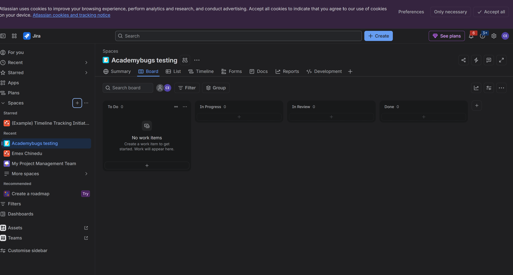

# Test Plan: Demoblaze
**Tester:** Chinedu · **Date:** 11/7/2026
## About this plan
(Two lines: what demoblaze is, and what this plan is for.)
A practice shop for phones, laptops and monitors, the plan is to test and see what's wrong with the shop
## 1. What I will test
- Login page, sign up, product page, add product to cart, place order, pictures, content of the product page and product prices
## 2. What I will not test, and why
- Anything written by the company, including videos and pictures, does not affect what would make a customer decide not to shop on the website. 
## 3. Who
- Tester
## 4. When
- 11/7/2026 to 11/8/2026
## 5. Devices and browsers
- laptop, Phones, Chrome, Safari
## 6. What could go wrong (risks)
| Risk | Money, Mission, Mistake or Makeup | Why it matters |
|---|---|---|
| Sign up | Money | It allows new user to register |
| Login | Money | It allows registered user to get in | Money |
| Click Product page | Money | It allows user to see the contents |
## 7. When I stop
- When the bugs are gone
____
## Assignment 2: My Jira board
**Project:** AcademyBugs Testing · **Key:** AT
**My columns:** To do → In progress → In review → Done

## Assignment 3: AcademyBugs bugs in Jira
| Jira number | Summary | Severity | Priority | Why this priority |
|---|---|---|---|---|
| AT-1 | Cart total shows more than the items cost | Critial |  | |
| AT-2 | The sign-in button is not centered, but customers can still sign in successfully | Low | | |
| AT-3 | Customers are unable to navigate to the manufacturer's page | Low |  | |
| AT-4 | The customer's intended action failed | High | | |
| AT-5 | Customers can see unwanted spaces in the images, causing a minor visual issue | Low | | |

## Assignment 4: The life of AT-1
| Date | From | To | Who | What happened |
|---|---|---|---|---|
| 11/5/2026 | To Do | In Progress | Developer | Started fixing |
| 11/6/2026  | In Progress | Retest | Developer | Said it is fixed |
| 11/7/2026 | Retest | In progress | Me | Not fixed |
**My retest comment:** The bug is still there, please fix it
## Assignment 5: Interview practice
**Question:** Tell me the life of a bug, from when you find it to when it is closed.
**My answer:**A tester finds a bug and reports it. The developer fixes it, and the tester retests it to make sure it is working correctly. If the bug is gone, it is marked as closed. 
(      )
