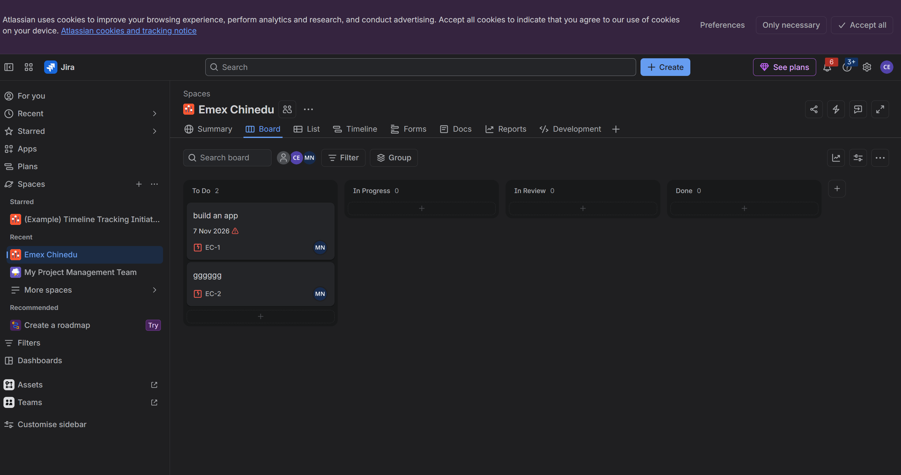

# Test Plan: Demoblaze
**Tester:** Chinedu · **Date:** 11/7/2026
## About this plan
(Two lines: what demoblaze is, and what this plan is for.)
A practice shop for phones, laptops and monitors, the plan is to test and see what's wrong with the shop
## 1. What I will test
- Login page, sign up, product page, add product to cart, place order, pictures, content of the product page and product prices
## 2. What I will not test, and why
- Anything written by the company, including videos and pictures, does not affect what would make a customer decide not to shop on the website. 
## 3. Who
- Tester
## 4. When
- 11/7/2026 to 11/8/2026
## 5. Devices and browsers
- laptop, Phones, Chrome, Safari
## 6. What could go wrong (risks)
| Risk | Money, Mission, Mistake or Makeup | Why it matters |
|---|---|---|
| Sign up | Money | It allows new user to register |
| Login | Money | It allows registered user to get in | Money |
| Click Product page | Money | It allows user to see the contents |
## 7. When I stop
- When the bugs are gone
____
## Assignment 2: My Jira board
**Project:** AcademyBugs Testing · **Key:** ____
**My columns:** To do → In progress → In review → Done

